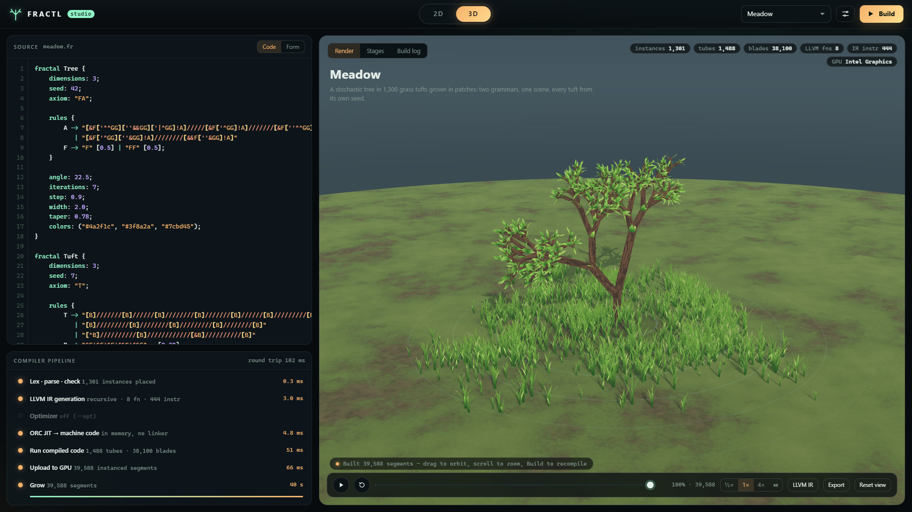
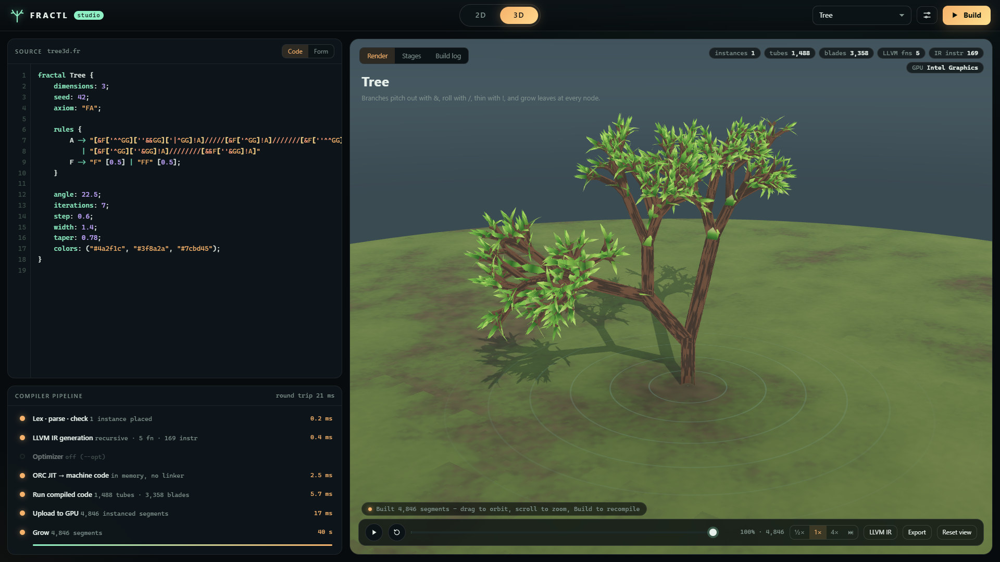
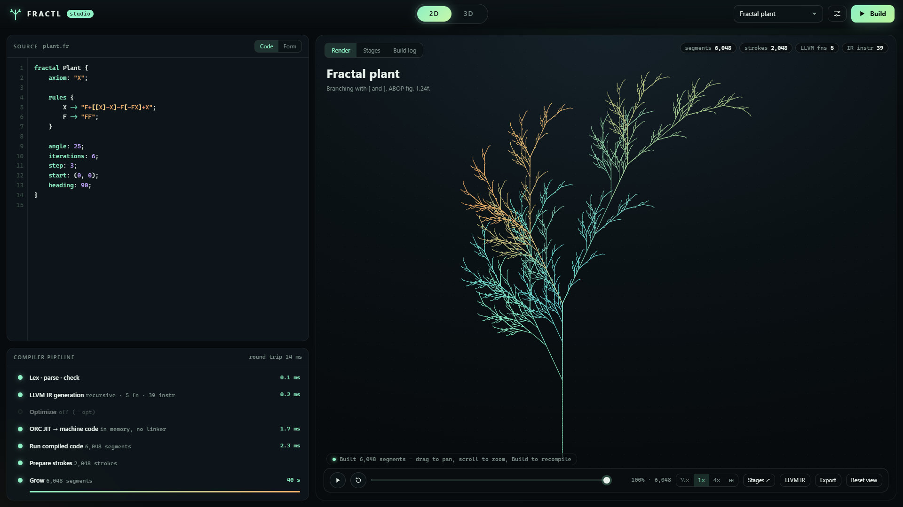
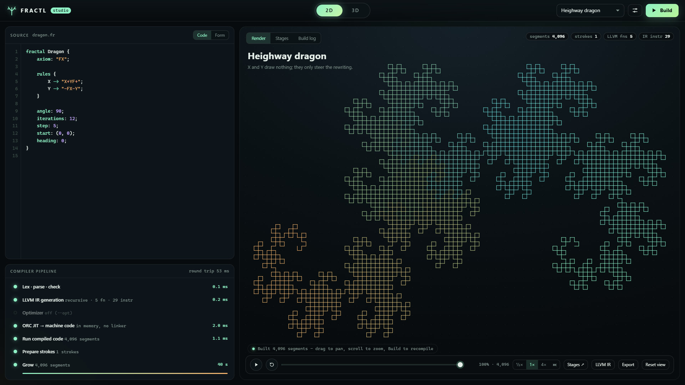

# FRACTL

A compiler from L-system grammars to native code via LLVM.

You describe a fractal or a plant in a small language: an axiom, rewriting rules
(optionally weighted and seeded), and turtle-graphics parameters. `fractlc` compiles
it to LLVM IR and then to machine code, either as a native object file or in memory
with LLVM's ORC JIT. The compiled program draws the result as an SVG (2D) or a 3D
segment stream. **FRACTL Studio** is a local browser front end that compiles what you
type and grows the model live, in 2D or 3D.

|  |  |
| --- | --- |
| **Meadow:** two grammars and one scene, 1,301 instances, 39,588 segments | **Tree:** weighted rules, tubes for wood, blades for leaves |
|  |  |
| **Fractal plant:** branching with `[` and `]` | **Heighway dragon:** `X` and `Y` only steer the rewriting |

## Features

- **A real compiler pipeline:** a hand-written lexer, an LL(1) recursive-descent
  parser with line-numbered errors, semantic checks, L-system expansion, a turtle IR,
  LLVM code generation and a C runtime.
- **IR the size of the grammar:** one LLVM function per rule symbol, so adding
  iterations or instances costs run time, not compile time. The meadow compiles to
  531 lines of IR, against 201,463 when unrolled.
- **Ahead-of-time or JIT:** emit an ELF object and link it with `runtime.o`, or run
  the program in memory with ORC JIT, with no linker.
- **Stochastic grammars:** `F -> "F+F" [0.6] | "F-F" [0.4];` with a `seed:`. The same
  seed always grows the same plant.
- **3D turtle and scenes:** pitch, roll, tubes and blades, tapering width, colour
  palettes, and scenes that `place` and `scatter` many instances, each from its own
  seed.
- **A peephole optimizer:** `--opt` folds adjacent constant rotations without
  changing the drawing.
- **Tooling:** FRACTL Studio (live build, per-phase timings, LLVM IR view, growth
  replay, `.svg`/`.obj` export), a static stage viewer and the Stage 1 web form.
- **Tested:** about 80,000 frontend checks, plus runtime, pipeline and
  mode-equivalence suites and byte-for-byte golden outputs.

## The language

```
fractal Koch {
    axiom: "F--F--F";
    rules { F -> "F+F--F+F"; }
    angle: 60;  iterations: 4;  step: 4;
    start: (150, 350);  heading: 0;
}
```

| Symbol | Meaning |
| --- | --- |
| `F` / `G` | Move forward drawing a tube / a flat blade (a line in 2D) |
| `f` | Move forward without drawing |
| `+` `-` | Turn left / right by `angle` |
| `&` `^` | Pitch down / up (3D) |
| `\` `/` | Roll left / right (3D) |
| `\|` | Turn around |
| `!` | Multiply the width by `taper` |
| `'` | Switch to the next colour in `colors` |
| `[` `]` | Save / restore the turtle state |
| other letters | Draw nothing; they only steer the rewriting |

Fields: `axiom`, `rules`, `angle`, `iterations`, `step`, `start`, `heading`, `seed`,
`dimensions`, `width`, `taper` and `colors`. A file may hold several fractals and a
`scene`; see [meadow.fr](meadow.fr) and [STAGE3.md](STAGE3.md).

## How it works

```
.fr source -> lexer -> parser + checks -> rewriter -> lowering -> turtle IR
           -> LLVM IR (one function per rule) -> [--opt] -> ORC JIT  or  object + link
           -> runtime.c -> .svg (2D) / .f3d (3D)
```

The frontend (`lexer.hpp` to `lower.hpp`) is header-only C++17 with no LLVM
dependency. The backend (`codegen.cpp`, `jit.cpp`, `emit_object.cpp`) uses LLVM 20.
The two halves meet at `ast.hpp` and `ir.hpp`.

## Getting started

### Requirements

The compiler and the Studio server run on **Linux**. On Windows, use **WSL** with
Ubuntu; the Windows launchers call into WSL for you.

```bash
sudo apt update
sudo apt install build-essential llvm-20-dev zlib1g-dev libxml2-dev python3
```

Tested with Ubuntu 26.04, GCC 15.2, LLVM 20.1.8, Python 3.14 and GNU Make 4.4.
`fractlc` links LLVM statically, so `llvm-20-dev` must provide the static libraries
(Ubuntu's package does). The Makefile finds `llvm-config-20`, or `llvm-config` if it
reports version 20; set `LLVM_CONFIG=/path/to/llvm-config` to override. On Ubuntu
releases without LLVM 20 in the archive, install it from <https://apt.llvm.org>.

### Build and test

```bash
git clone https://github.com/Rahul-Prakaash/FRACTL.git
cd FRACTL
make            # builds fractlc, runtime.o and fr_frontend
make test       # frontend, runtime, pipeline, golden-file and mode-equivalence tests
```

Every suite should print `0 failed`, and the golden step should match all 16 reference
files in `tests/golden/`. `make clean` removes everything the build created.

## Usage

**Compile ahead of time** (object file, link, run):

```bash
./fractlc koch.fr -o build/koch.o --svg build/koch.svg --emit-ir build/koch.ll
cc build/koch.o runtime.o -lm -o build/koch && ./build/koch   # writes build/koch.svg
```

**Or JIT it in memory:**

```bash
./fractlc meadow.fr --jit --out build/meadow.f3d --timings
```

`make koch` (or any demo name) runs the ahead-of-time steps for one demo.
`./fractlc` with no arguments lists every option (`--unroll`, `--opt`, `--ir-only`,
...). `./fr_frontend koch.fr --all` prints each frontend stage: tokens, AST, expanded
string and turtle IR.

**FRACTL Studio** (run `make` first):

- Windows: double-click **`Launch FRACTL Studio.bat`**. It starts the server in WSL
  and opens Edge at <http://127.0.0.1:8732>.
- Linux: `python3 studio.py`, then open <http://127.0.0.1:8732>.

3D needs a browser with WebGL2 (Edge or Chrome); 2D works everywhere.
**`Launch FRACTL Classic UI.bat`** (or `python3 web_ui.py 8733`) starts the Stage 1 web
form, and `viewer/index.html` opens the static stage viewer
([viewer/README.md](viewer/README.md)).

**Frontend only, on Windows without WSL:** `.\build.ps1 -Test` builds
`fr_frontend.exe` and runs the frontend tests with MinGW `g++`.

## Repository layout

| Path | Contents |
| --- | --- |
| `lexer.hpp`, `parser.hpp`, `ast.hpp` | Scanner, LL(1) recursive-descent parser, AST |
| `rewriter.hpp`, `rng.hpp`, `scene.hpp`, `lower.hpp`, `ir.hpp` | L-system expansion, seeded RNG, scene placement, turtle IR |
| `frontend.hpp`, `fr_frontend.cpp`, `json.hpp` | Frontend entry point and its debug driver |
| `codegen.cpp`, `emit_object.cpp`, `jit.cpp`, `fractlc.cpp` | LLVM code generation, object emission, ORC JIT, compiler driver |
| `runtime.c`, `runtime.h` | Turtle runtime linked into every compiled program |
| `*.fr`, `studio/presets/*.fr` | Demo programs and Studio presets |
| `tests/` | Test suites and golden outputs |
| `studio.py`, `studio/` | FRACTL Studio (server and single-page app) |
| `web_ui.py`, `viewer/` | Stage 1 web form and the static stage viewer |
| `tools/` | Offline presentation bundle (`make bundle`) and a Studio screenshot script |
| `docs/` | Member write-ups (PDF and HTML sources) and README images |

## Documentation

| Document | What it covers |
| --- | --- |
| [STAGE1.md](STAGE1.md), [STAGE2.md](STAGE2.md), [STAGE3.md](STAGE3.md) | The language, the compiler and the results, stage by stage |
| [FRONTEND.md](FRONTEND.md) | Lexer, parser, rewriter and lowering; the frontend/backend interface |
| [PRESENTATION.md](PRESENTATION.md) | Demo script and presentation checklist |
| [docs/](docs/) | Write-ups on the frontend, the backend, and tooling and Studio |

## Authors

- **Rahul Prakaash** ([@Rahul-Prakaash](https://github.com/Rahul-Prakaash))
- **Aditya Karthik** ([@aditya8732](https://github.com/aditya8732))

Built for the BCSE307P Compiler Design Lab at Vellore Institute of Technology.
